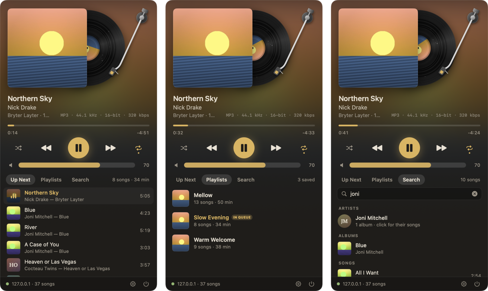

# Needle

A menu-bar remote for [MPD](https://www.musicpd.org/), built for an always-on home music server that plays a 263,600-song library through an amp. Needle lives in the Mac's menu bar as a small level meter beside the song that's playing; click it and a panel drops down with the record.



## What it does

- **The record.** The cover sits in its sleeve; when the server plays, the vinyl slides out and turns at a true 33⅓ rpm, and the tonearm swings over, drops onto the lead-in groove and tracks inward as the song plays. Pause and it stops where it was; stop and it slides back in. The panel's backdrop is the cover itself, blurred, and the controls borrow the cover's colour.
- **Everything live.** Needle holds an `idle` connection, so anything that happens on the server — from this panel, from `mpc` on the server, from ncmpcpp, from the phone — shows up at once.
- **The controls you'd expect:** play/pause, previous (back to the start first, like a CD player), next, a scrubber, shuffle, repeat (off → all → one song), volume with mute.
- **Up Next, Playlists, Search.** The queue with the playing song marked; the saved playlists (click to play, or shuffle, or append); and a search that answers artists and albums as you type from a local index of the library, then songs a moment later. Return plays the first song.
- **From the menu bar itself:** ⌥-click or middle-click to play/pause without opening anything, scroll over the icon to change the volume, right-click for volume presets and playlists.
- **Media keys and Control Center.** While the server is playing, the keyboard's play/pause, next and previous keys drive it, and Control Center's media tile shows the song, its cover and a scrubber. Offline or stopped, Needle lets go of the keys.
- **A terminal command**, `needle`: `needle status`, `needle toggle`, `needle next`, `needle vol +5`, `needle load slow-evening`, `needle search pale blue eyes`.

## Things it is careful about

- **It never wakes a sleeping drive.** Cover art is read from the server only for the song that is playing (that drive is spinning anyway) and kept on this Mac, one image per album folder. Lists show only covers already cached here, so browsing never touches the drives; everything else Needle asks for comes from MPD's in-memory song database.
- **The volume doesn't jump.** A PipeWire output reopens at 100 % when playback starts from stopped, and the amp is loud. When Needle starts playback, it puts the previous volume back the moment MPD reports the jump (Settings can turn this off).
- **Away from home it goes quiet.** If this Mac is not on the server's network, Needle stops retrying on a timer — it never keeps knocking on whatever owns the server's address on someone else's network — and reconnects when the network changes or the panel is opened.
- **It costs nothing while hidden.** The menu-bar meter is animated by Core Animation, outside the app (0.0 % CPU measured while playing); the panel's clocks stop when it closes.

## Install

```bash
scripts/install.sh
```

Builds a release, bundles `~/Applications/Needle.app`, starts it at login with a LaunchAgent (`com.greggaynor.needle`), and links the CLI as `~/.local/bin/needle`. The first time it runs, macOS asks whether Needle may find devices on the local network: allow it, or it cannot reach the server. `scripts/uninstall.sh` removes it all (`--all` also clears its settings and cover cache).

The server defaults to `localhost:6600`. Change it in the panel's Settings (the gear, or ⌘,), or set `NEEDLE_HOST`/`NEEDLE_PORT` (or the classic `MPD_HOST`, which may be `password@host`, and `MPD_PORT`) for the CLI.

## In the panel

| key | does |
|---|---|
| space | play / pause |
| ← → | previous / next |
| ↑ ↓ | volume ±5 |
| ⌘F | search |
| ⌘1 ⌘2 ⌘3 | Up Next, Playlists, Search |
| ⌘, | settings |
| esc | clear the search, then close |

`pkill -USR1 -x Needle` toggles the panel, so a window-manager hotkey can open it.

## Building and testing

Swift Package, no dependencies, builds with the Command Line Tools alone (`swift build`). Note for this toolchain: in the macOS 27 SDK SwiftUI's `@State` is a macro whose plugin ships only with Xcode, so views use `@Local` (in `Support.swift`), a `@StateObject`-backed stand-in.

- `scripts/mock-mpd.py [port] [timeout]` is a small fake MPD — playing, with covers, live `idle` notifications, MPD's habit of hanging up on silent clients (`timeout`, 60 s by default) and even the PipeWire volume quirk — so the controls can be exercised without touching the real music.
- `Needle selftest` (with `NEEDLE_HOST=127.0.0.1 NEEDLE_PORT=6601`, against the mock) drives the real player model through every control and checks what the server ends up doing. It refuses to run against anything but 127.0.0.1.
- `Needle probe` is a timed, read-only health check of every path the app uses against the real server.
- `Needle --show [--tab queue|playlists|search] [--query words] [--settings]` opens the panel on launch; with `NEEDLE_PIN=1` it stays open when focus moves, for screenshots. Outside the .app bundle, a bare `Needle` (or `needle`) prints the status; `--app` starts the menu-bar app instead.

| file | what |
|---|---|
| `MPD.swift` | the wire: one connection, command lists, binary chunks, deadlines |
| `MPDClient.swift` | self-healing command channel and every command Needle sends |
| `Player.swift` | the model: three channels (commands, idle, art), reconnects, every control |
| `LibraryIndex.swift` | albums and artists held locally for instant search |
| `Artwork.swift` | covers, their cache, and the colour taken from each |
| `Hero.swift` | the record, the tonearm, generated covers |
| `PanelView.swift`, `Lists.swift` | the rest of the panel |
| `StatusItem.swift` | the menu-bar item and its meter |
| `NowPlaying.swift` | media keys and Control Center |
| `CLI.swift`, `SelfTest.swift`, `Icon.swift` | the terminal command, the self-test, the app icon (drawn by the same code as the record) |


## Licence

GPL-2.0 — see `LICENSE`.
